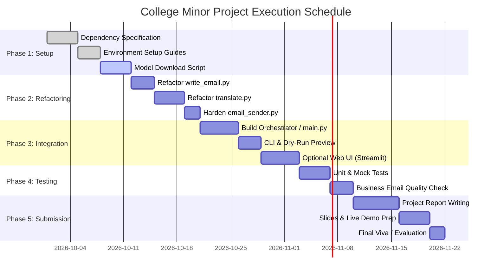

# Project Action Plan & Roadmap

## Project: English-to-Japanese Email Translator
**Academic Program:** College Minor Project  
**Repository:** [vkhere/college-minor-project-01](https://github.com/vkhere/college-minor-project-01)  
**Target Completion Date:** Semester Minor Project Evaluation  
**Status:** Active Execution / Module Integration  

---

## 1. Executive Summary & Objective

The primary objective of this Action Plan is to steer the development, integration, hardening, testing, and final academic submission of the **English-to-Japanese Email Translator**. 

While the individual modular scripts (`write_email.py`, `translate.py`, and `email_sender.py`) demonstrate core proof-of-concept functionality, the project requires architectural integration, security hardening (eliminating hardcoded absolute paths), automated testing, and comprehensive documentation to achieve academic excellence.

---

## 2. Current Status Assessment

| Module | File | Current State | Critical Observations | Priority Action |
|---|---|---|---|---|
| **Email Generator** | `email_trans/write_email.py` | 🟡 Functional Prototype | Hardcoded sample topic; prints to stdout; requires active `NVIDIA_API_KEY`. | Expose as callable function; add CLI arguments. |
| **Translation Engine** | `email_trans/translate.py` | 🟡 Functional Prototype | Hardcoded local absolute model path (`C:\Users\kumar\...`); incomplete `model.generate(...)` code block in git blob. | Replace hardcoded path with dynamic env var; download standard Hugging Face model if local missing. |
| **Email Dispatcher** | `email_trans/email_sender.py` | 🟢 Production-Ready Logic | Clean function signature, robust MIME formatting, structured exception handling. | Parameterize via config / environment variables. |
| **End-to-End Runner** | *None* | 🔴 Missing | No single entrypoint connecting the 3 stages into an automated pipeline. | Create `main.py` / `orchestrator.py` CLI interface. |

---

## 3. Project Phases & Work Breakdown Structure (WBS)

```
English-to-Japanese Email Translator
├── Phase 1: Environment & Dependency Standardization (Weeks 1 - 2)
├── Phase 2: Code Refactoring & Security Hardening (Weeks 3 - 4)
├── Phase 3: Pipeline Integration & Orchestration (Weeks 5 - 6)
├── Phase 4: Testing, Evaluation & Quality Assurance (Weeks 7 - 8)
└── Phase 5: Submission Preparation & Demonstration (Weeks 9 - 10)
```

---

### Phase 1: Environment & Dependency Standardization
**Goal:** Establish reproducible execution across different machines and OS environments.

- [x] **Task 1.1:** Document complete runtime dependencies in `REQUIREMENTS.md`.
- [x] **Task 1.2:** Create standardized `SETUP.md` for team onboarding.
- [ ] **Task 1.3:** Create a minimal `requirements.txt` file pinned to compatible PyTorch and Transformers versions.
- [ ] **Task 1.4:** Create `.env.example` file with placeholder variables for `NVIDIA_API_KEY`, `SENDER_EMAIL`, `SENDER_APP_PASSWORD`, and `MODEL_PATH`.
- [ ] **Task 1.5:** Write an automated model acquisition script (`scripts/download_model.py`) to download `facebook/nllb-200-distilled-600M` automatically.

---

### Phase 2: Code Refactoring & Security Hardening
**Goal:** Transform standalone demonstration scripts into modular, reusable, production-ready libraries.

- [ ] **Task 2.1:** **Refactor `write_email.py`**:
  - Wrap generation logic in `generate_email(topic: str, tone: str = "formal") -> str`.
  - Add input validation to prevent blank prompts.
  - Read `NVIDIA_API_KEY` with graceful error logging if absent.
- [ ] **Task 2.2:** **Refactor `translate.py`**:
  - Replace hardcoded Windows local path with `os.getenv("MODEL_PATH", "facebook/nllb-200-distilled-600M")`.
  - Fix the `model.generate` invocation with proper parameter closing, beam search tuning (`num_beams=4`), and max length controls.
  - Implement dynamic fallback: If local directory is not found, load directly from Hugging Face hub with caching.
- [ ] **Task 2.3:** **Refactor `email_sender.py`**:
  - Verify email address format using standard regex before attempting SMTP handshake.
  - Add optional subject prefix tagging (e.g., `[Auto-Translated]`).
  - Sanitize HTML inputs to prevent markup injection.

---

### Phase 3: Pipeline Integration & Orchestration
**Goal:** Build a cohesive workflow connecting all three components.

- [ ] **Task 3.1:** Create `email_trans/orchestrator.py` (or `main.py`):
  - Chain execution: `Topic Input` $\rightarrow$ `generate_email()` $\rightarrow$ `translate()` $\rightarrow$ `send_email()`.
- [ ] **Task 3.2:** Build an interactive Command Line Interface (CLI):
  - Support arguments via `argparse` or `click`:
    ```bash
    python -m email_trans.main --topic "Project milestone reached" --to "client@company.jp" --subject "Project Update"
    ```
- [ ] **Task 3.3:** Add interactive dry-run / confirmation mode:
  - Display both the English draft and the Japanese translation on screen.
  - Prompt user: `Do you want to send this email? [y/N]`.
- [ ] **Task 3.4 (Stretch Goal):** Create a lightweight UI using **Streamlit** or **Gradio** for college project presentation.

---

### Phase 4: Testing & Quality Assurance
**Goal:** Validate translation quality, exception resilience, and system performance.

- [ ] **Task 4.1: Unit Testing**:
  - Test `email_sender` with mock SMTP server (`unittest.mock` / `smtpd`).
  - Test `translate` with short mock phrases.
  - Test `write_email` prompt formatting and temperature clamping.
- [ ] **Task 4.2: Translation Quality Evaluation**:
  - Test 15 standard business email scenarios (invoicing, scheduling, delivery status, apologies, inquiries).
  - Inspect Japanese output for polite business register (*Keigo* / *Teineigo*).
- [ ] **Task 4.3: Error & Edge Case Stress Testing**:
  - Invalid SMTP password $\rightarrow$ verify clear user warning.
  - Extremely long input (>1000 words) $\rightarrow$ verify chunking / truncation handling without crashing.
  - Network timeout $\rightarrow$ verify graceful retry or error reporting.

---

### Phase 5: Submission Preparation & Demonstration
**Goal:** Complete academic project requirements, slide decks, and live demo.

- [x] **Task 5.1:** Produce full software engineering documentation:
  - `PRD.md` (Product Requirements Document)
  - `README.md` (Project Overview & Quickstart)
  - `SETUP.md` (Installation Manual)
  - `WALKTHROUGH.md` (Architecture & Code Flow)
  - `RULES.md` (Coding Standards & Security Protocol)
  - `LEARNINGS.md` (Retrospective & Technical Knowledge)
  - `REQUIREMENTS.md` (Dependency Specifications)
- [ ] **Task 5.2:** Prepare college project report / synopsis (Introduction, Literature Survey, System Architecture, Results, Conclusion).
- [ ] **Task 5.3:** Create presentation slides (PowerPoint / PDF) highlighting AI & NMT pipeline architecture.
- [ ] **Task 5.4:** Record a 2-minute backup demo video showcasing end-to-end execution.

---

## 4. Schedule & Milestones Timeline



---

## 5. Risk Management Matrix

| Risk ID | Description | Severity | Likelihood | Mitigation Strategy |
|---|---|---|---|---|
| **R-01** | **Hardcoded Path Failures:** Team members cannot run `translate.py` due to machine-specific directory path. | High | High | Use environment variable `MODEL_PATH` or fallback to downloading the official `facebook/nllb-200-distilled-600M` model automatically. |
| **R-02** | **NVIDIA API Rate Limits:** API quota exhausted during testing or presentation. | High | Medium | Cache sample LLM email outputs in a local mock file for offline demonstration mode. |
| **R-03** | **VRAM Shortage on CPU/Low-tier Laptops:** PyTorch runs out of memory when loading model. | High | Medium | Use the 600M parameter distilled variant (`nllb-200-distilled-600M`) and enable `torch.float32` CPU quantization if needed. |
| **R-04** | **Gmail SMTP Authentication Block:** Google blocks login due to basic auth deprecation. | Medium | High | Enforce mandatory 2-Step Verification + 16-character Google App Password in documentation and setup guides. |
| **R-05** | **Translation Register Mismatch:** Model outputs casual Japanese instead of respectful corporate tone. | Medium | Medium | Include explicit polite register prompting or post-processing rules. |

---

## 6. Definition of Done (DoD)

A milestone is considered complete only when:
1. Code runs error-free from a clean virtual environment using `python -m email_trans.main`.
2. All secrets are loaded from `.env` without any hardcoded credentials.
3. Unit and integration tests pass on the target machine.
4. Output email arrives in the recipient inbox with correctly styled Japanese and English cards.
5. All relevant markdown documentation is updated to reflect changes.
