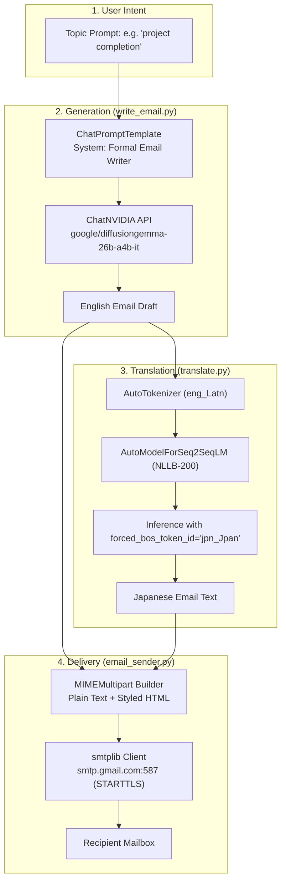

# Product Requirements Document (PRD)

## Project: English-to-Japanese Email Translator
**Type:** College Minor Project  
**Version:** 1.0.0  
**Status:** In Progress / Prototyping  
**Author / Team:** Devendra Kumar & Team  
**Repository:** [vkhere/college-minor-project-01](https://github.com/vkhere/college-minor-project-01)  

---

## 1. Executive Summary

In global business and academia, cross-border correspondence between English speakers and Japanese clients or institutions poses distinct challenges. Japanese business communication adheres to strict conventions of formality, tone, and etiquette (Keigo / 敬語). 

The **English-to-Japanese Email Translator** is an automated, end-to-end communication assistant that:
1. Generates professionally styled formal business emails from simple bullet-point topics using advanced generative Large Language Models.
2. Translates the generated English email into Japanese using high-fidelity multilingual neural machine translation models (Seq2Seq / NLLB-200 architecture).
3. Transmits the email directly via SMTP, presenting the Japanese translation as primary communication while embedding the original English text for clarity and transparency.

---

## 2. Problem Statement

### 2.1 The Challenge
- **Linguistic and Cultural Barriers:** Japanese business culture relies heavily on structured formal phrasing, honorifics, and polite greetings. Literal translations from generic tools often appear abrasive or awkward.
- **Time Inefficiency:** Drafting formal correspondence and finding accurate domain translations requires substantial manual effort or translation service expense.
- **Context Loss:** When non-native speakers send emails translated through ordinary translators, the recipient has no easy access to the source message to resolve ambiguous idioms.

### 2.2 The Solution
An integrated AI pipeline combining:
- A state-of-the-art instructed LLM (Google DiffusionGemma 26B on NVIDIA AI Foundation Endpoints) tasked specifically with formal English email composition.
- A dedicated Neural Machine Translation Seq2Seq model (Meta NLLB-200 family) focused on accurate translation to Japanese script (`jpn_Jpan`).
- An automated dual-language email dispatcher presenting both translated Japanese and original English in an elegant HTML email template.

---

## 3. Product Vision & Goals

### 3.1 Vision
To deliver an accessible, privacy-conscious, and automated developer toolkit that removes language barriers in professional cross-border email correspondence.

### 3.2 Goals
- **Automate drafting:** Produce a polished corporate email from a short topic string in under 5 seconds.
- **Accurate translation:** Retain formal tone and technical accuracy when converting English to Japanese.
- **Seamless delivery:** Send multipart plain-text and HTML emails with zero formatting glitches across desktop and mobile clients.
- **Modularity:** Ensure each core component (writer, translator, sender) functions independently or as a unified chain.

---

## 4. Target Personas & User Scenarios

| Persona | Description | Primary Use Case |
|---|---|---|
| **International Student / Researcher** | Interacting with Japanese universities, professors, or labs. | Inquiring about admissions, scheduling interviews, or submitting project updates. |
| **Global Software Developer / Freelancer** | Working with Japanese tech firms or offshore clients. | Sending formal project milestones, status reports, and bug delivery notifications. |
| **Business Development Manager** | Managing client relationships across Japan and Western markets. | Outreaching, scheduling meetings, and delivering polite corporate follow-ups. |

---

## 5. User Stories

1. **US-01 (Email Generation):** As a user with limited time, I want to input a brief sentence like `"informing client for project completion"` so that the system generates a formal, comprehensive English email draft.
2. **US-02 (Machine Translation):** As a sender communicating with Japanese native speakers, I want the email translated into natural Japanese without relying on external third-party paid web translation UIs.
3. **US-03 (Dual-Language Presentation):** As a recipient, I want to read the message in Japanese first, but have access to the original English text beneath it for instant verification.
4. **US-04 (Automated Dispatch):** As a busy user, I want the system to send the generated email directly through my secure Gmail SMTP credentials without manual copy-pasting.

---

## 6. Functional Requirements

### 6.1 Email Generation (`write_email.py`)
- **FR-1.1:** System shall accept a topic parameter string describing the email intent.
- **FR-1.2:** System shall invoke `ChatNVIDIA` with model `google/diffusiongemma-26b-a4b-it` via LangChain ChatPromptTemplate.
- **FR-1.3:** System prompt must instruct the model to adopt a strictly formal, professional email tone.
- **FR-1.4:** Temperature shall default to `0.5` to ensure balanced creativity and deterministic structure.

### 6.2 Translation Engine (`translate.py`)
- **FR-2.1:** System shall load a local Seq2Seq multilingual translation model using Hugging Face `transformers` (`AutoTokenizer` and `AutoModelForSeq2SeqLM`).
- **FR-2.2:** Source language shall be configured to `eng_Latn` (Latin English).
- **FR-2.3:** Target language token shall be resolved to `jpn_Jpan` (Japanese Script).
- **FR-2.4:** Inference shall execute within `torch.no_grad()` with `forced_bos_token_id=jpn_id`.
- **FR-2.5:** Text truncation shall be set to a maximum sequence length of 512 tokens.
- **FR-2.6:** Translation logic shall be packaged as a LangChain `RunnableLambda` for chain composability.

### 6.3 Email Delivery Engine (`email_sender.py`)
- **FR-3.1:** System shall provide `send_email(...)` accepting sender, recipient, subject, Japanese body, and English body.
- **FR-3.2:** System shall establish a secure connection using `smtplib.SMTP` with `STARTTLS` on port 587.
- **FR-3.3:** Messages must be constructed as `MIMEMultipart("alternative")` supporting both plain text and rich HTML.
- **FR-3.4:** HTML email must render:
  - Prominent Japanese translation block in a styled card (`#f8f9fa` background, `#d63384` accent).
  - Reference English block in a distinct amber card (`#fff3cd` background, `#856404` accent).
  - A subtle footer declaring automated translation.
- **FR-3.5:** Function shall return a standardized dictionary `{"success": bool, "message": str}` with custom handling for `SMTPAuthenticationError` and general exceptions.

---

## 7. Non-Functional Requirements

- **Performance & Latency:**
  - LLM Generation: $\le 3.5\text{ seconds}$ on NVIDIA Cloud Endpoints.
  - Seq2Seq Inference: $\le 4.0\text{ seconds}$ on modern multi-core CPU, $\le 1.0\text{ second}$ on CUDA GPU.
  - SMTP Delivery: $\le 2.0\text{ seconds}$ over broadband network.
- **Reliability:**
  - Graceful degradation if local GPU is unavailable (fallback to CPU execution).
  - Explicit warning when credentials or App Passwords fail.
- **Security & Privacy:**
  - Zero hardcoding of sensitive credentials (API keys and SMTP passwords strictly managed via `.env`).
  - Use of application-specific passwords rather than master account passwords for Gmail.
- **Extensibility:**
  - Loose coupling between generator, translator, and sender to facilitate replacement of models or frontends.

---

## 8. System Architecture

---

## 9. Technology Stack Justification

| Layer | Component | Choice | Justification |
|---|---|---|---|
| **Prompting & LLM** | LangChain Core & NVIDIA Endpoints | `ChatNVIDIA` + `DiffusionGemma 26B` | High parameter count yields exceptional formal English composition without requiring local 50GB GPU VRAM. |
| **Translation Engine** | Hugging Face Transformers | `AutoModelForSeq2SeqLM` (NLLB Architecture) | Meta's No Language Left Behind excels in 200+ language pairs including English to Japanese with explicit token control. |
| **Framework Integration**| LangChain LCEL | `RunnableLambda` | Allows modular chaining (`prompt | llm | translator | emailer`) in future iterations. |
| **Dispatch Protocol** | Python Standard Library | `smtplib` + `email.mime` | Zero heavy dependencies; rock-solid RFC 5322 compliance. |

---

## 10. Constraints & Assumptions

### Constraints
- **Model Path Dependency:** Currently depends on local storage of the Seq2Seq model weights.
- **NVIDIA Rate Limits:** Depends on active developer tier credits on `integrate.api.nvidia.com`.
- **Gmail SMTP Policy:** Requires modern 2-Factor Authentication and an active Google App Password.

### Assumptions
- Sender possesses internet connectivity to contact NVIDIA API and Gmail SMTP endpoints.
- Emails do not exceed 512 input tokens for translation.

---

## 11. Out of Scope (Version 1.0)

- Graphical User Interface (GUI/Web Dashboard).
- Reverse translation (Japanese to English).
- IMAP incoming mail reader and auto-reply threads.
- Multi-attachment binary sending (PDFs, images).

---

## 12. Future Roadmap

- **v1.1 (CLI Orchestrator):** Single command-line interface tying all three files together dynamically (`python -m email_trans.main --topic "..." --to "..."`).
- **v1.2 (Interactive Web UI):** Streamlit or Gradio interactive interface with live dual-column preview.
- **v2.0 (Bidirectional Agent):** Two-way inbox translator listening via IMAP, automatically translating incoming Japanese client replies back to English.
